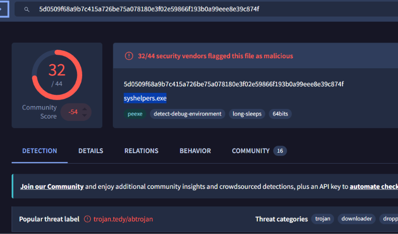
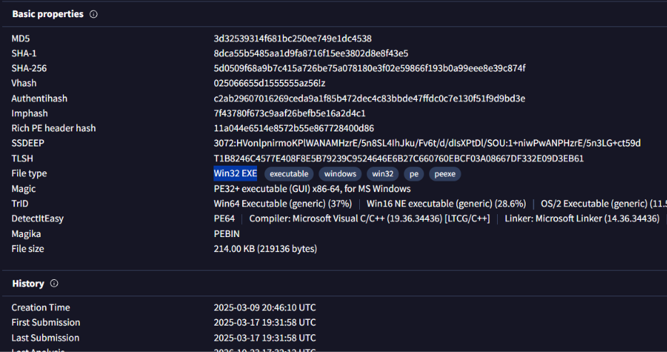
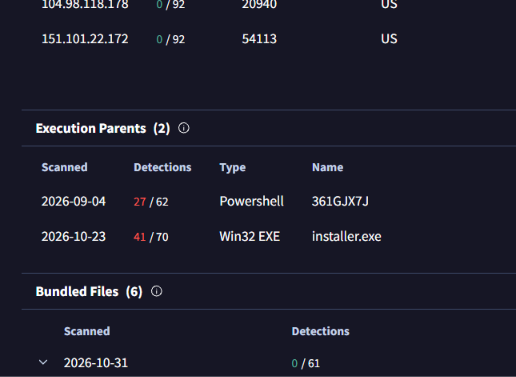
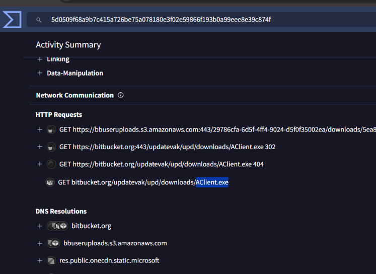
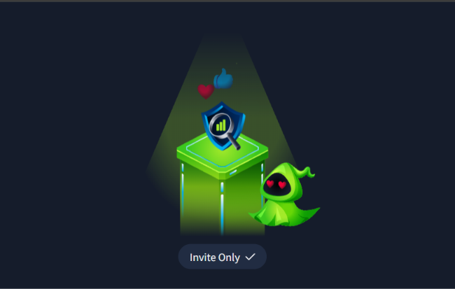
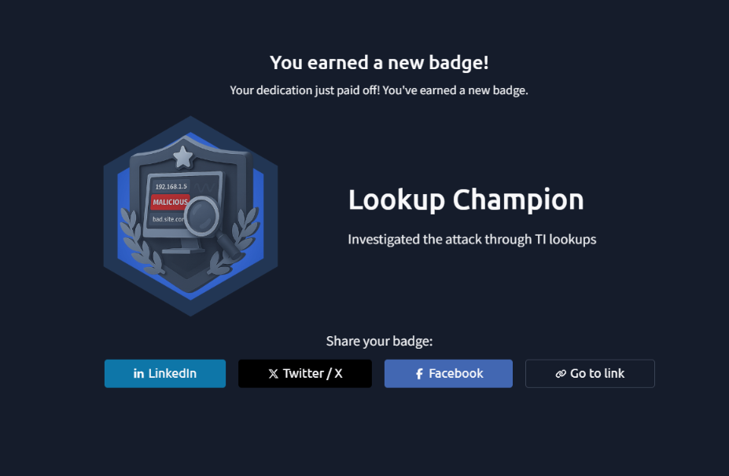

# Invite Only

## About challenge
You are an SOC analyst on the SOC team at Managed Server Provider TrySecureMe. Today, you are supporting an L3 analyst in investigating flagged IPs, hashes, URLs, or domains as part of IR activities. One of the L1 analysts flagged two suspicious findings early in the morning and escalated them. Your task is to analyse these findings further and distil the information into usable threat intelligence.

Flagged IP: 101[.]99[.]76[.]120
Flagged SHA256 hash: 5d0509f68a9b7c415a726be75a078180e3f02e59866f193b0a99eee8e39c874f

We recently purchased a new threat intelligence search application called TryDetectThis2.0. You can use this application to gather information on the indicators above.

## Findings
Investigated a set of escalated artifacts using open-source intelligence and localized threat platform tools. The investigation uncovered a multi-stage malware delivery campaign exploiting hijacked, legitimate Discord invite links to lure targets to malicious servers. The attack utilized a modern "ClickFix" phishing technique to deceive users, ultimately deploying ChromeKatz to harvest browser cookies alongside a payload linked to the AsyncRAT malware family.

# Indicator of Compromise

## 🔍 Indicators of Compromise (IoCs)

During the investigation, the following artifacts and network indicators were identified as part of the malicious infrastructure:

### Network Indicators
*   **Malicious Staging IP:** `185.172.128.243` — Hosted the fake verification portal and served malicious payloads.
*   **Delivery Vector:** Hijacked or compromised Discord invite links used to redirect targets to unauthorized domains.

### Host-Based Artifacts
*   **Initial Dropper:** `installer.exe` — The multi-stage executable disguised as an official bot verification file or browser tool.
*   **Tooling (Credential Theft):** **ChromeKatz** — Deployed by the attacker to dump active memory from Google Chrome to hijack session cookies and credentials.
*   **Persistent Backdoor:** **AsyncRAT** — The Remote Access Trojan established on the host to provide ongoing command-and-control (C2) functionality.

---

## 🛡️ Remediation & Recommendations

To mitigate this specific threat vector and clean up affected infrastructure, the following defense and response actions are recommended:

### 1. Host Isolation & Eradication
*   **Network Isolation:** Immediately disconnect any host communicating with `185.172.128.243` from the local network to contain the AsyncRAT beaconing.
*   **System Re-imaging:** Because AsyncRAT grants complete administrative backdoor control, remediation requires a full system wipe and OS re-installation rather than basic anti-malware scanning.

### 2. Session & Identity Revocation
*   **Invalidate Browser Cookies:** Because **ChromeKatz** compromises active browser states, all active web sessions (corporate logins, cloud portals, external platforms) initiated from the endpoint must be manually revoked server-side.
*   **Credential Rotation:** Force an immediate password reset across all corporate and personal accounts stored or accessed on the target machine.

### 3. Perimeter & Platform Defenses
*   **IP Blacklisting:** Configure firewall rules to drop all traffic routing to or from the known malicious C2 IP address.
*   **External Chat Guardrails:** Implement endpoint security policies to monitor or restrict execution parameters triggered via link redirects on messaging applications like Discord.

### 4. User Awareness Focus
*   **"ClickFix" Campaign Training:** Conduct targeted phishing exercises highlighting the **ClickFix** social engineering model. Emphasize that legitimate communication applications will never prompt users to copy-paste terminal code, run obfuscated PowerShell scripts, or manually install executables to verify an account or fix a rendering error.

# Screenshots related in investigation

**Hashed filename that's being escalated**

---

**Hashed file type**

---

**Execution Parents Name**

---

**File name that's being dropped**

---

**Invite Only challenge completion**

---

**Look Up Champion Badge**

