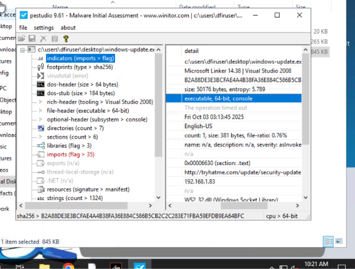
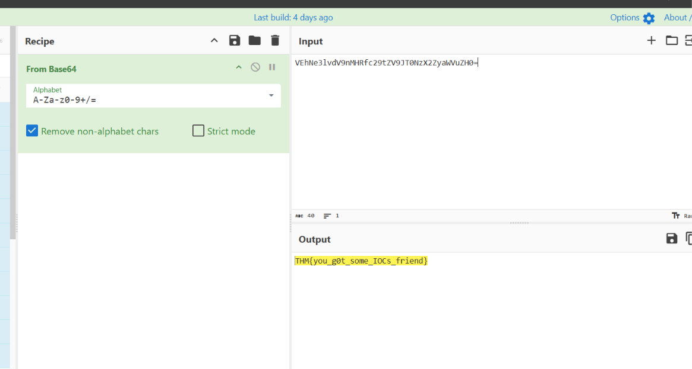
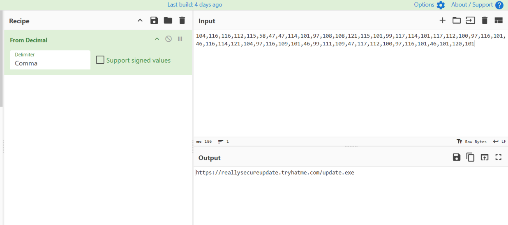
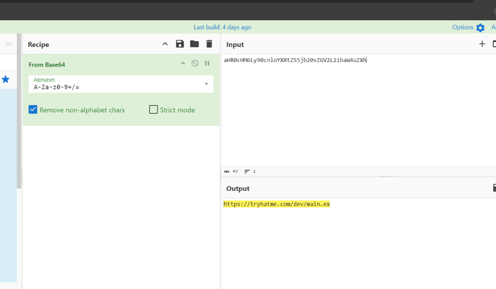

# Shadow Trace

## About challenge
It’s the middle of the night shift. You’re the only analyst in the SOC when a manager calls in urgently: a suspicious file was found on a user's machine and needs immediate review.

You open the file and start digging. Something doesn’t look normal for a company updater, and at the same time, the EDR throws a couple of alerts.

Your task: analyse the file, collect anything to identify it, gather any potential IOCs, correlate and analyse the alerts for potential malicious behaviour. It’s up to you to piece together what’s happening before it spreads further.

## Findings
During static binary analysis and EDR log correlation, a malicious 64-bit updater executable named `windows-update.exe` was investigated. The binary mimics a valid application updater but targets known spoofed external web servers and contains obfuscated code to deploy secondary payloads. 

A Chrome browser telemetry alert caught an embedded execution of an obfuscated JavaScript integer array. When de-obfuscated through CyberChef using a comma delimiter, the character codes decoded directly to a hidden staging payload domain. Additionally, suspicious PowerShell command alerts flagged an obfuscated Base64 download cradle pulling directly from a development endpoint. PEStudio checks verified malicious hash signatures matched vendor virus definitions and uncovered a socket communication library import indicating direct outbound connectivity.

# Indicator of Compromise

## Email & Network Infrastructure
- **Malicious URL within file:** http://tryhatme.com
- **Malicious C2 callback domain:** ://tryhatme.com
- **PowerShell trigger malicious URL:** https://tryhatme.com
- **Chrome browser trigger malicious URL:** https://tryhatme.com

## Host & Artifact Files
- **Exposed file analyzed on desktop:** windows-update.exe
- **File saved by chrome.exe process:** test.txt
- **Sha256 hash of windows-update.exe:** b2a88de3e3bcfae4a4b38fa36e884c586b5cb2c2c283e71fba59efdb9ea64bfc
- **Socket communication library loaded:** WS2_32.dll
- **Binary Architecture structure:** 64-bit

## Compromised Identities
- **DFIRUser** (Active local user profile path targeted on the machine)

## Recommendations
- **Isolate the affected workstation:** Isolate `DFIRUser`'s host machine via the EDR suite to cut ongoing communication back to the C2 node.
- **Apply domain & URL perimeter block:** Configure firewalls and Secure Email Gateways to block outbound routing to `tryhatme.com` and its subdomains.
- **Set an EDR hash quarantine rule:** Deploy a global block on hash `b2a88de3e3bcfae4a4b38fa36e884c586b5cb2c2c283e71fba59efdb9ea64bfc` to instantly isolate copies across endpoints.
- **Audit local user folder dumps:** Scour local machine storage paths for unknown modifications or the sudden appearance of the `test.txt` binary blob artifact.

# Screenshots related in investigation

**Malicious File Type**

---

**Malicious Base64**

---

**Malicious Decimal Value that triggered the alert**

---

**Malicious URL to download the file**

---

**Shadow Trace Completion**

---

**Malware Explorer Badge**

