# TryHackme: Snapped Phish-ing Line

## About challenge
As a member of the IT department at SwiftSpend Financial, you are responsible for assisting employees with technical concerns. What initially appeared to be a routine day quickly escalated when multiple employees across different departments reported receiving a suspicious email. Several users noted unusual characteristics in the message, and unfortunately, some had already submitted their credentials and were no longer able to access their accounts. With the potential for a wider compromise, the incident has been escalated for investigation. Your task is to analyze the available evidence, determine the scope of the attack, and uncover how the adversary operated.

## Findings
Several emails are sent to our employees and they are all malicious. Attack specifically crafts targeted emails send to our employees. The emails have an attachment that redirects them to a website pretending to be microsoft. Attacker left a folder in the website and was found our employees harvested credentials in a log file. By using this technique the attacker was successfully gained access to some of our employees and locked their accounts.

# Indicator of Compromise

## Email & Network Infrastracture
- **Sender email:** Accounts.Payable@groupmarketingonline.icu
- **Spoofed domain:** groupmarketingonline.icu
- **Actual domain:** braemarhowells.com
- **Exfiltration email:** m3npat@yandex.com
- **Malicious Redirection Root Domain:** kennaroads.buzz
- **Harvested employee credentials:** isaiah.puzon@gmail.com, michael.ascot@swiftspend.finance, zoe.duncan@swiftspend.finance, derick.marshall@swiftspend.finance, michelle.chen@swiftspend.finance

## Host & Artifact Files
- **Exposed file left by attacker: Update365.zip
- **Sha256 file of Update364.zip:** ba3c15267393419eb08c7b2652b8b6b39b406ef300ae8a18fee4d16b19ac9686
- **Total of files in compressed archive:** 49

## Compromised Identities
- isaiah.puzon@gmail.com
- michael.ascot@swiftspend.finance 
- zoe.duncan@swiftspend.finance
- derick.marshall@swiftspend.finance 
- michelle.chen@swiftspend.finance

## Recommendations
- **Reset compromised credentials:** Prevents attacker from accessing the harvested credentials
- **Block the sending email**: To avoid getting other phishing email from this email
- **Block the exfiltration email:** Avoid any sensitive credential being send to it
- **Set a rule to block the malicious sha256 file:** To ensure that same attachment will not reach our employee

---

# Screenshots related in investigation

**Phishing email sent to one of the employee**

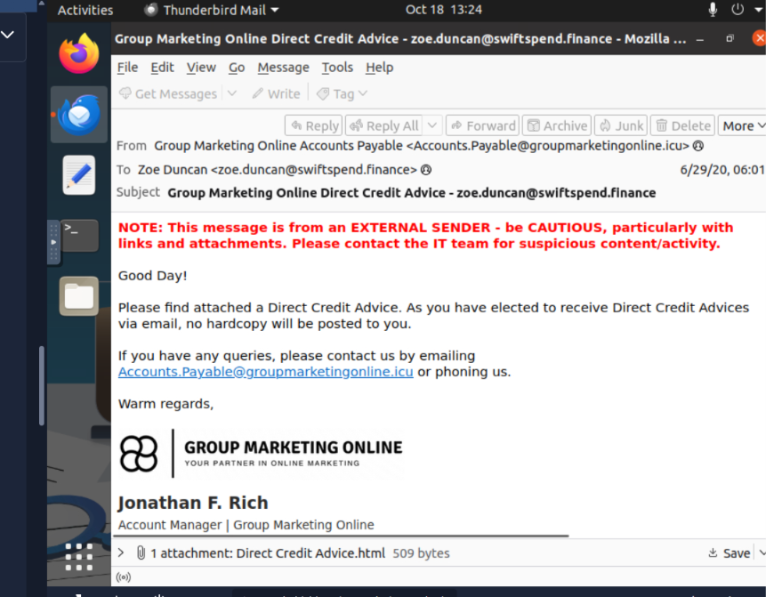

---

**Raw email of the sent email to Zoe Duncan**

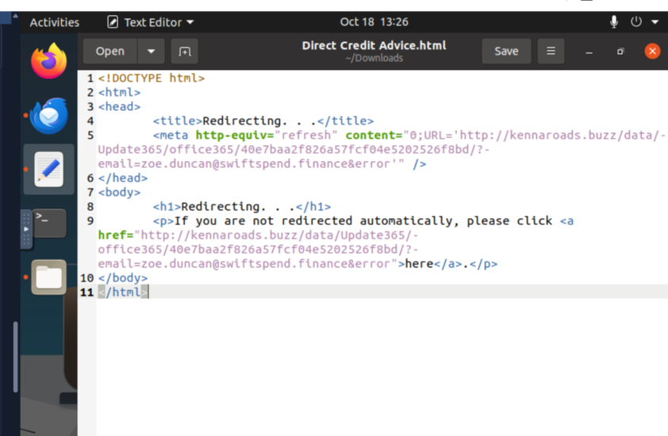

---

**Phishing website of the attacker pretending as Microsoft**

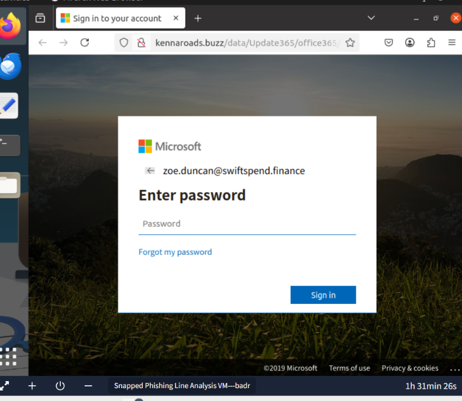

---

**Left folder in attacker's phishing website**

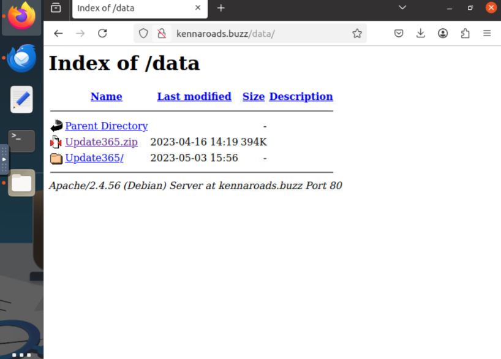

---

**Archived file hash conversion in shell**

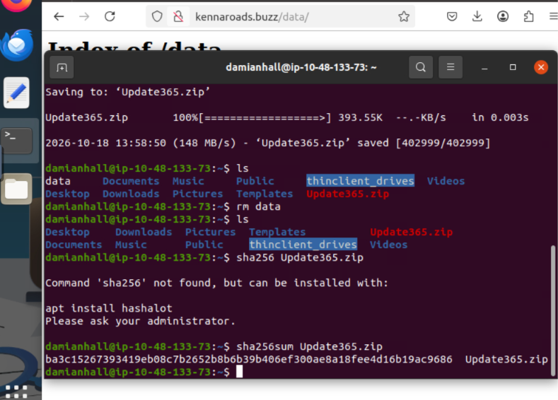

---

**File hash threat category**

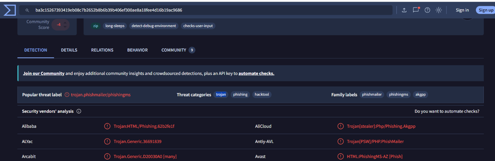

---

**File hash contained files**

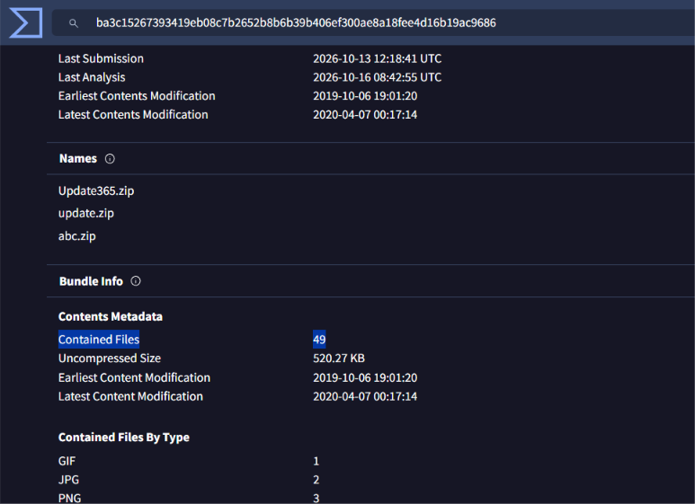

---

**Harvested credentials in log file**

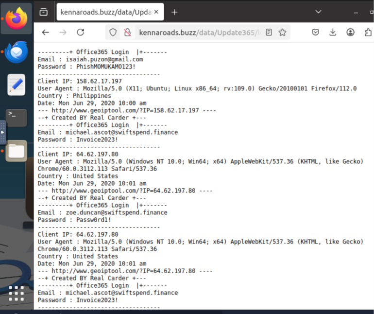

---

**Retrieving the Flag**

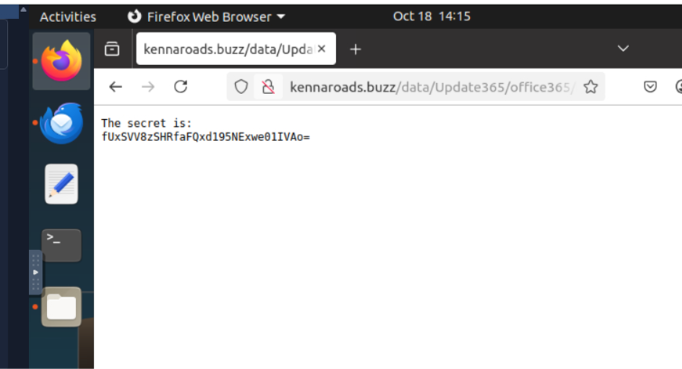

---

**Decoding the flag from Base64**

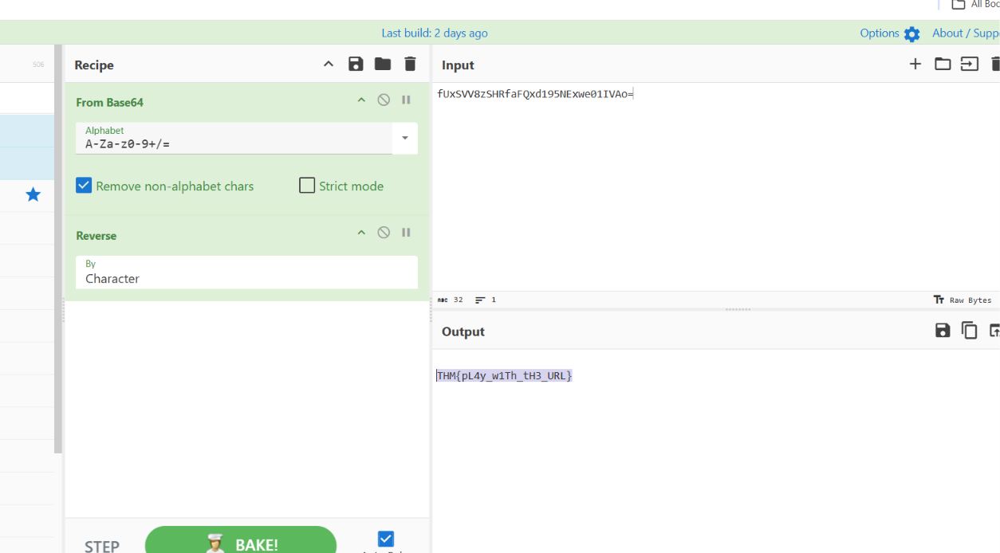

---

**Completing Snapped Phish-ing Line challenge**

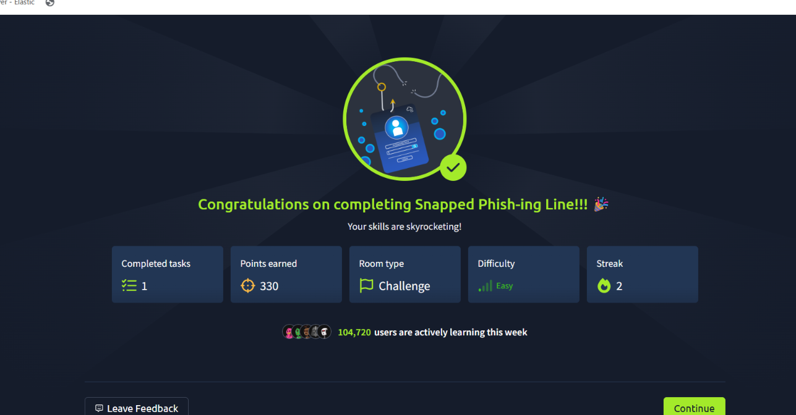