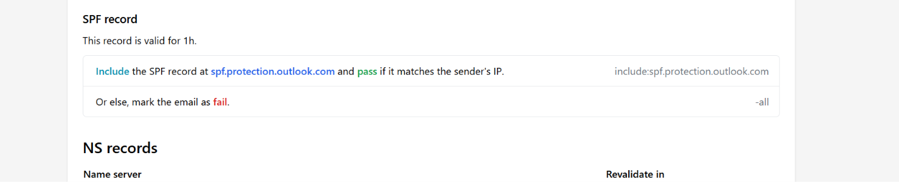
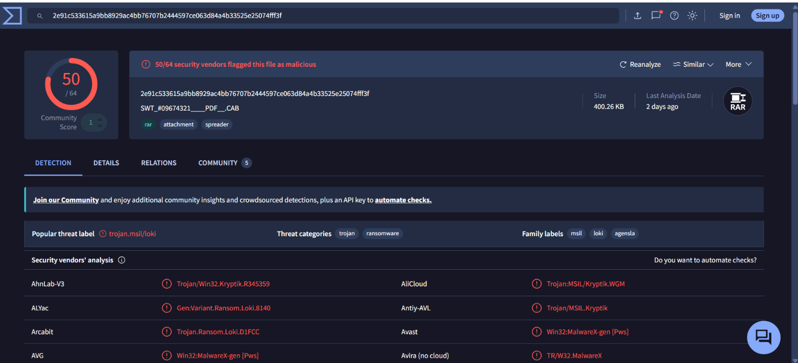
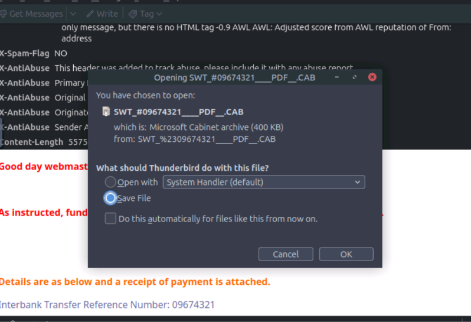
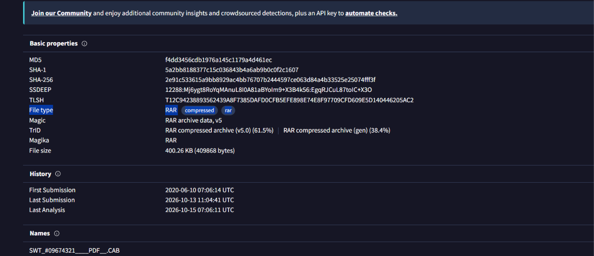

# TryHackMe: The Greenholt Phish

## About challenge
A sales executive at Greenholt PLC has reported a suspicious email received from a known customer. The message raised several red flags: a generic greeting, an unexpected request for a money transfer, and an unsolicited attachment. According to the employee, this behavior does not align with the customer’s usual communication style. Concerned that the email may be malicious, the message has been escalated to the SOC (Security Operations Center) for further investigation. Your goal is to analyze the provided email sample and determine whether it is legitimate or part of a phishing attempt.

## Incident type
Confirmed malicious email / phishing campaign

## Findings 
Investigated the email and learned that the sender is pretending to be Mr. James Jackson sending a payment details attached in the email with a fake transfer reference number. The malicious email did not pass SPF of the domain and was found malicious in VirusTotal.

---

## Email Artifacts
- **Sender email address:** info@mutawamarine.com
- **Originating IP address:** 192.119.71.157
- **Recipient email address:** webmaster@redacted.org
- **Number of attachment:** 1
- **Attachment file type:** RAR

---

## Recommended actions
- **Purge the email matching this SHA256 hash or sender address from all employee mailboxes globally.**
- **Implement an immediate block rule on the gateway for the originating IP address**

---

**Investigating IP address in ipinfo** 

---

**Checking SPF record** 

---

**Checking hash file in VirusTotal** 

---

**Attachment filename: SWT ATTACHMENT** 

---

**Checking for real file type in VirusTotal** 

---

**Getting my new badge!** 

